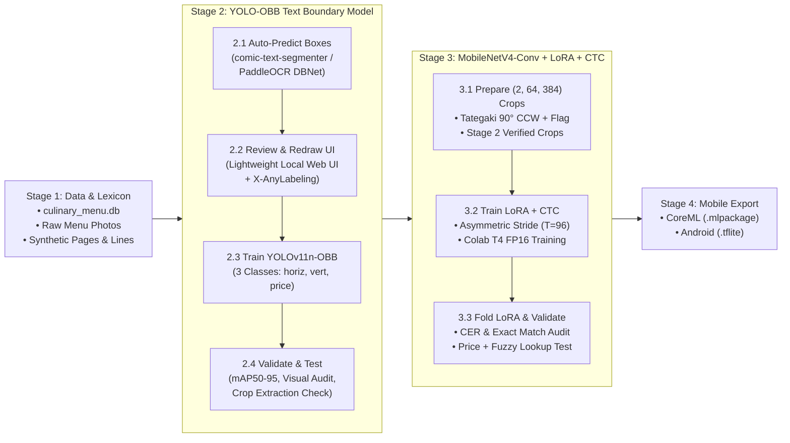

> Historical reference; filesystem paths reflect the current layout. Current commands and status: [project overview](../overview.md).

# Master Implementation Plan: Cross-Platform Japanese Restaurant Menu OCR & Instant Culinary Translation

## 1. Executive Summary & Core Constraints
- **Target Application**: Full-page automatic Japanese restaurant menu recognition and instant offline culinary translation for **iOS (iPhone 15 ANE)** and **Android (NPU/GPU/CPU)**.
- **Performance Target**: End-to-end full-page detection + recognition + translation in **$< 60\text{ms}$ on iPhone 15** and **$< 120\text{ms}$ on Android** (well under the $1,000\text{ms}$ budget).
- **Stage-Gated Execution**:
  - **Stage 1**: Implemented data gathering, lexicon, rendering, and augmentation: 9,000 labeled synthetic lines, 1,000 OBB pages, 100 generated menus, 400 real menus, and 200 real interiors. The 10,000-line hybrid target remains pending reviewed real crops.
  - **Stage 2**: Dedicated **YOLO-OBB Text Boundary Detection** pipeline (broken into **2.1, 2.2, 2.3, 2.4**).
  - **Stage 3**: Dedicated **OCR Sequence Recognizer (`MobileNetV4-Conv-Small + LoRA + CTC`)** training & validation (**3.1, 3.2, 3.3**).
  - **Stage 4**: Cross-Platform Mobile Export (CoreML `.mlpackage` & Android `.tflite`) & Profiling.
- **Stage 1 GenAI Budget / Accounting**: The retained handwritten-menu seed collection used its full **100-call** budget. Procedural rendering, Tabelog HTTP downloads, and geometric augmentation make no LLM API calls; assistant orchestration/logging/visual review can still consume tokens. Retired negative-image experimentation is outside that retained ledger; see Stage 1 accounting notes below.

---

## 2. Key Architectural Decisions & Technical Trap Mitigations

1. **Cross-Platform Vision Backbone (`MobileNetV4-Conv-Small`)**: Chosen over MobileViT and FastViT for universal hardware compatibility across both iOS CoreML (Apple Neural Engine) and Android LiteRT/TFLite (NNAPI, GPU, XNNPACK) with zero operator fallback risk.
2. **Text Boundary Detection (`YOLOv11n-OBB`)**: Uses Oriented Bounding Boxes $(x, y, w, h, \theta)$ to cleanly separate both vertical (*Tategaki*) and horizontal (*Yokogaki*) text lines while filtering out menu clutter (photos, wood grain, borders) in $\approx 5\text{ms}$.
3. **Trap Patch 1 — Vertical Text (*Tategaki*) $90^\circ$ CCW Glyph Rotation & `ー` vs. `一` Disambiguation**:
   - Rotating a vertical text column $90^\circ$ CCW converts top-to-bottom reading order into left-to-right for CTC, but places every Kanji glyph on its left side ($-90^\circ$) and causes vertical *Chōonpu* `ー` (`｜` rotated $90^\circ$ CCW $\to$ `—`) to collide visually with horizontal *ichi* `一` (`—`).
   - **Solution (Option A + Orientation Flag)**: `synthetic_renderer.py` renders vertical strings upright top-to-bottom on a $(384, 64)$ strip *first* (applying vertical punctuation substitution: `ー` $\to$ vertical bar, `「」` $\to$ `﹁﹂`, `（）` $\to$ `︵︶`), and **then** rotates the strip $90^\circ$ CCW into $(64, 384)$ to match inference 1:1. Additionally, the YOLO-OBB class (`0: dish_horiz` vs. `1: dish_vert`) is passed as an explicit 2nd input channel (`(2, 64, 384)`) so the Conv filters and CTC head disambiguate sideways vertical glyphs from upright horizontal glyphs.
4. **Trap Patch 2 — Asymmetric Stride Table for CTC Sequence Length ($T = 96$)**:
   - Default `mobilenetv4_conv_small` downsamples width by $32\times$ ($384 / 32 = 12$ steps), which fails on lines $> 5$ characters under CTC ($T \ge 2L + 1$).
   - **Solution**: Lock horizontal stride to $4\times$ total (`(2, 2)` in Stem and Stage 1; `(2, 1)` in Stages 2, 3, and 4) to guarantee $T = 384 / 4 = 96$ time steps.
5. **Trap Patch 3 — 5-Step Kanji Price Parser (Counters, Tax Suffixes, `時価`, Positional vs. Multiplicative)**:
   - Prevents naive concatenation bugs (such as parsing `一串 二百五十円` as `1250円`). Explicitly separates portion counters (`一串`, `二貫`, `一皿`), tax flags (`税込`, `税抜`, `外税`), range waves (`〜`), market price (`時価`), and supports both positional (`八五〇`) and multiplicative (`千二百五十`) Kanji numerals.
6. **Trap Patch 4 — Non-Blocking Stage 1 Synthetic Build & Real-Data Merge Hook**:
   - `synthetic_renderer.py` builds a runnable dataset archive immediately from the 9,000 synthetic lines + 1,000 full-page OBB composites without blocking on manual annotations, and provides `scripts/merge_real_dataset.py` to merge the 1,000 real lines asynchronously.
7. **Fuzzy / Error-Tolerant Dictionary Lookup (Bi-Gram + Levenshtein)**: Character 2-gram inverted index + Levenshtein distance matcher ($\le 2\text{ms}$) ensures high recall even under 1–2 character OCR errors (e.g., `鳥` vs `烏`).

---

## 3. End-to-End System Architecture & Stage Progression



---

## 4. Stage 1: Implemented Data Preparation and Annotation Handoff

Stage 1 now includes the base synthetic dataset, generated handwritten-menu
seeds, real Tabelog photos, and text-preserving menu/interior augmentation.
Integrity audits passed for these artifacts. Real-photo annotation, detector
training, CTC recognizer training, and mobile export are not completed by this
milestone. The detailed record is [stage1_summary.md](../stage1_data/stage1_summary.md).

### A. Current Artifact Inventory and Sample Units

| Artifact | Current result | Location / status |
| --- | --- | --- |
| Culinary SQLite lexicon | 47,216 canonical entries | `data/processed/lexicon/culinary_menu.db` |
| Vocabulary | 1,722 characters; minimum frequency 10; blank ID 0 | `data/processed/synthetic_base_v1/vocab.json`, `data/processed/synthetic_base_v1/character_frequency.json` |
| Base labeled synthetic CTC lines | 9,000 | `data/processed/synthetic_base_v1/ctc_lines/` |
| Synthetic full-page detector images | 1,000 at 640x640; 9,000 existing OBB regions | `data/processed/synthetic_base_v1/yolo_obb/` |
| Generated handwritten menus | 100 images; 100 completed primary seed calls | `data/raw/genai_seeds/menu_images/` |
| Real restaurant menu images | 400 images from 400 restaurants | `data/raw/tabelog_menus/`; all transcriptions unverified |
| Real restaurant interiors | 200 images from 200 restaurants | `data/raw/tabelog_interiors/`; category-screened, not automatically text-free negatives |
| Earlier augmentation run | 1,100 menu/composite pairs; 9,000 derived CTC crops | `data/processed/augmentation/run_1100/`; retained historical run |
| Current 3D augmentation run | 500 menu/composite pairs; 4,050 derived CTC crops | `data/processed/augmentation/run_500/`; integrity audit passed |
| Base synthetic archive | 9,000 labeled lines, 1,000 pages, generated-menu seeds | `data/processed/synthetic_base_v1/menu_dataset_10k.tar.gz` |

A line crop, a full menu page, a restaurant background, and an augmented image
are different sample units. Derived crops reuse source text and are correlated
with their source images. Do not add these counts together as independent
labeled lines. Later Tabelog/augmentation outputs remain outside the base
archive; it has not been rebuilt as a hybrid real/synthetic dataset.

The original non-blocking CTC split and future hybrid target remain:

| Split | Built base corpus | Planned hybrid after reviewed real crops |
| --- | ---: | ---: |
| Synthetic training | 7,500 | 8,000 |
| Real training | 0 | 500 |
| Synthetic validation | 1,000 | 1,000 |
| Test holdout | 500 synthetic | 500 real |
| Total labeled lines | **9,000** | **10,000; not yet assembled** |

Base synthetic lines are 4-10 characters, with 50/50 horizontal and rotated
vertical orientations in each split. The future merge requires 1,000 reviewed
real **line crops**, not 1,000 photographs. Existing synthetic test lines and
corresponding detector pages must be reassigned consistently when a real
holdout replaces them. The merge hook implements this policy; no real merge
has been exercised yet.

### B. Implemented Components

#### 1. Lexicon, Search, and Kanji Price Parser

`src/data/lexicon_builder.py` builds `menu_dictionary` and the character-bigram
inverted index from licensed JMdict culinary candidates and curated-component
menu variants. `source` and `category` preserve provenance. Generated variants
are not independently attested dishes; broad glossary/polysemous matches need
editorial review. Allergen and dietary flags remain `unknown`.

The deterministic parser separates five concerns before evaluating numerals:

1. `時価` produces a market-price flag and no numeric price.
2. `税込`, `内税`, `税抜`, `外税`, and `+税` provide tax metadata.
3. Portion counters such as `一串` and `二貫` are separated before price parsing.
4. Wave/range/from markers identify minimum prices.
5. Positional Kanji (`八五〇` -> 850, `一、二八〇` -> 1280) and multiplicative
   Kanji (`千二百五十` -> 1250) are evaluated separately.

Exact lookup and bigram/Levenshtein fallback passed the recorded desktop test
set. Base-audit p95 was 0.0168 ms exact / 0.1791 ms one-typo. These measurements
are not exhaustive worst-case or mobile timing guarantees.

#### 2. Generated Menu Seeds and Budget Accounting

`src/data/genai_seed_collector.py` and `scripts/data/menu_image_batch.py` retain
persistent attempt accounting in `data/raw/genai_seeds/usage_ledger.json`.
The initial procedural build made zero GenAI calls. The user's subsequent
request reallocated the original 40 item / 40 texture / 20 reserve plan to
**100 handwritten-menu image calls**, made with the built-in imagegen tool in
small batches and then batches of 12. All 100 completed successfully.

Each generated PNG has a JSON sidecar with its prompt, intended text, dimensions,
checksum, and synthetic provenance. `collection_manifest.json` indexes the set.
Intended prompt text is **not** a verified transcription of the rendered image;
no line boxes or CTC ground truth are invented for unannotated generated menus.
The primary retained budget has no remaining calls.

The separate GenAI-negative background experiment was retired: its asset folder,
generation scripts, test, and compiled caches were removed. The base archive
contains none of those negative assets. The retained 100-call ledger describes
the positive menu-seed collection, not a reconstructed all-time project/provider
usage total including the removed experiment. HTTP scraping and local
augmentation make no LLM API calls; assistant/tool orchestration and any vision
review still have token overhead.

#### 3. Procedural Grammar, Fonts, and Base Renderer

`src/data/menu_grammar.py` generates menu variants locally and enforces at least
10 instances of each of the 1,722 selected renderable vocabulary characters.
`scripts/download_fonts.py` downloaded and verified these seven fonts, retaining
publisher notices, URLs, family names, and checksums under `data/resources/fonts/`:
`KouzanBrushFont.ttf`, `AoyagiSouseki.ttf`, `YujiBoku-Regular.ttf`,
`YujiMai-Regular.ttf`, `ShipporiMincho-Bold.ttf`, `HachiMaruPop-Regular.ttf`, and
`KleeOne-SemiBold.ttf`. JMdict attribution and CC BY-SA 4.0 notices are retained
with the source/derived data.

`src/data/synthetic_renderer.py` produces the original 9,000 grayscale lines,
1,000 pages, labels, orientation metadata, stride configuration, and archive.
It includes elastic deformation, ink bleed/erosion, perspective, lighting, and
procedural backgrounds. Its synthetic page labels already contain 3,000
horizontal-dish, 3,000 vertical-dish, and 3,000 price regions.

For vertical text, draw upright glyphs top-to-bottom on a canvas **width 64,
height 384**, substitute vertical punctuation, then rotate the complete strip
90 degrees counterclockwise to **width 384, height 64**. `orientation_flag=1`
provides a constant second channel; horizontal crops use flag 0. The input
contract remains `(2,64,384)`, with width stride 4 and `T=96` declared in
`stride_config.json`; Stage 1 does not instantiate a recognizer.

The measured base build took **68.414 seconds before packaging**, approximately
79 seconds including packaging, exceeding the original under-60-second target.
This is a documented unmet performance target, not a verification success.

#### 4. Real Tabelog Menu and Interior Collection

`scripts/data/tabelog_scraper.py` delegates to `src/data/tabelog_collection.py`:

- `--photo-kind interior`: public `dtlphotolst/3/smp2/` galleries, saved under
  `data/raw/tabelog_interiors/` (200 selected images / 200 restaurants).
- `--photo-kind menu`: public `dtlmenu/photo/` galleries, saved under
  `data/raw/tabelog_menus/` (400 selected images / 400 restaurants).

The scraper uses gallery-specific HTML selectors and provided full-size image
links, validates decoding/dimensions/hashes, keeps one image per restaurant,
resumes safely, spaces requests, checks robots rules, and stops on blocked or
rate-limited access. Each image has source/restaurant/gallery URLs, photo ID,
caption, timestamp, dimensions, checksum, and review/annotation status. It does
not create OCR transcriptions or detector labels.

Earlier category screening used the assistant's vision on contact sheets and
selected full-size photos, not an OCR verification service or a Gemini
classification API. Obvious wrong-category candidates were quarantined and
replaced. The 200 interiors and first 100 real menus were category-screened.
The latest **300 additional menu photos were downloaded without visual
rejection at the user's request** and await manual review. Their audit confirms
the original 100 image files are unchanged. There are 20 menu contact-sheet
pages and 10 interior pages. The scraper's technical validity checks are not
proof of subject suitability, transcription accuracy, or a reuse license.

Real menus retain `text=null`, `annotations=[]`, and
`transcription_verified=false`. Rejected files are outside the selected
collection manifests. Interior photos can contain existing text/signage and are
not automatically approved empty-label negatives.

#### 5. Text-Preserving 3D Menu Augmentation and Compositing

`src/data/menu_augmentation.py`, `scripts/data/augment_menus.py`, and
`scripts/data/verify_menu_augmentation.py` provide the reusable pipeline.
Current inputs are generated menus, known synthetic pages, and selected real
interiors. Raw unannotated Tabelog menus are not automatically treated as labeled
augmentation/CTC sources.

The current geometry pinhole-projects a menu plane using pitch X, then yaw Y,
then roll Z, with these defaults:

| Parameter | Implemented range / meaning |
| --- | --- |
| Pitch | Magnitude 0-30 degrees, randomly forward/backward; signed -30 to +30 |
| Roll | -10 to +10 degrees, planar rotation |
| Yaw | -10 to +10 degrees, left/right slant |
| Menu scene scale | Random actual 0.5-1.2x relative to the saved augmented menu |
| Background | Seeded random choice within the sample's split, with replacement |

Menu fitting and placement preserve the complete visible menu, including at
scales above 1.0; only transparent padding may leave the frame. The same
homography transforms pixels and existing text polygons. Japanese text is not
mirrored or regenerated.

Outputs are paired images and **JSON text/provenance labels**, not new YOLO
`.txt` annotations. `menu/` holds transparent augmented PNGs; `composites/` holds
restaurant scenes. Sidecars retain exact known text or unverified intended text,
pose, scale, source hashes, matrices, menu boundary, and transformed source
polygons. Original class IDs are source provenance only. **New real/generated
menu and composite text-boundary assignment remains Stage 2 work.**

Where the source has known synthetic text and line polygons, CTC crops are
rectified from the composite, normalized to grayscale 384x64, and paired with
JSON labels plus `labels.jsonl`. Vertical crops retain the 90-degree CCW reading
order and orientation flag. Unverified generated-menu text does not become CTC
line ground truth.

The current `data/processed/augmentation/run_500/` run has 500 menu images, 500 composites,
400 train / 44 validation / 56 test pairs, 4,050 known text regions/CTC crops,
and 50 generated-menu samples with unverified intended text. It used 187
backgrounds and 140 actual scale factors above 1.0. Sampled scale was
0.5013-1.1998x; the geometry/text audit passed. The earlier 1,100-pair run remains
under `data/processed/augmentation/run_1100/`. Source-content and restaurant groups are disjoint
within each run; combining runs requires a joint leakage audit/resplit.

#### 6. Real-Photo Annotation and Hybrid Merge Hooks

`scripts/prelabel_real_menus.py` provides a local pretrained YOLO/PaddleOCR
inference hook exporting unreviewed X-AnyLabeling candidates.
`scripts/merge_real_dataset.py` validates reviewed 500 train / 500 test real line
records, dimensions, vocabulary, source-photo identities, strings, image hashes,
and textures before publishing a separate hybrid archive.

These hooks exist, but real-image inference/review and the full hybrid merge
have not been exercised with the collected photos. Stage 2 must use the actual
menu location `data/raw/tabelog_menus/`; the later-stage
`data/raw/real_menus/` path remains a planning placeholder, not a populated input.

### C. Verification Evidence and Reproduction

The latest recorded full regression run passed **52 tests**. Passing reports:

- `data/processed/synthetic_base_v1/verification_report.json`: base synthetic archive, lexicon, vocabulary,
  price edge cases, budget, orientation and OBB integrity.
- `data/raw/tabelog_menus/verification_report.json`: 400 distinct restaurants,
  400 distinct image hashes, paired sidecars and 20 contact-sheet pages.
- `data/raw/tabelog_menus/additional_300_report.json`: 300 additions, original
  100 image files unchanged, and no visual rejection in the additional batch.
- `data/raw/tabelog_interiors/verification_report.json`: 200 distinct restaurants,
  images/sidecars, 10 contact-sheet pages, category review status.
- `data/processed/augmentation/run_1100/verification_report.json` and
  `data/processed/augmentation/run_500/verification_report.json`: paired files, source-text
  preservation, geometry, orientation, CTC crops, and within-run split isolation.

```powershell
# Offline checks; no generation or scraping is performed by these commands.
python -m pytest -q
python -m scripts.data.verify_stage1_dataset --max-genai-calls 100
python -m scripts.data.verify_tabelog_collection --data-root data/raw/tabelog_menus --target 400
python -m scripts.data.verify_tabelog_collection --data-root data/raw/tabelog_interiors --target 200
python -m scripts.data.verify_menu_augmentation --data-root data/processed/augmentation/run_500

# Reusable collection / augmentation commands; use a fresh augmentation output.
python -m scripts.data.tabelog_scraper --photo-kind menu --target 400 --delay 2
python -m scripts.data.tabelog_scraper --photo-kind interior --target 200 --delay 2
python -m scripts.data.augment_menus --output-dir data/processed/augmentation/run_500_v2 --count 500 --max-pitch 30 --max-roll 10 --max-yaw 10 --min-scene-scale 0.5 --max-scene-scale 1.2
```

### D. Stage 1 Status and Remaining Handoff

**Completed:** base synthetic preparation, lexicon/parser/search, fonts,
100 retained generated menu seeds, 400 real menu candidates, 200 interior
backgrounds, reusable augmentation, text-label preservation, and integrity
checks. No detector/OCR model or mobile accuracy/latency gate is claimed.

**Pending / separate authorization:**

1. The user manually reviews the latest 300 real-menu candidates; no automated
   visual rejection is requested for that batch.
2. Real-menu text-boundary prelabeling, correction and class assignment belong
   to Stage 2. All real-menu text and generated prompt text need transcription
   verification before supervised CTC use.
3. Assemble 1,000 reviewed real line crops and the 10,000-line hybrid dataset
   with restaurant/source-content grouping across all included collections and
   augmentation runs. Review background menus/signage rather than silently
   assigning empty negative labels.
4. Review dictionary candidates/editorial quality and unknown recipe-dependent
   allergen/dietary fields; establish source reuse licensing where needed.
5. Retain the unmet base-build runtime target and unmeasured model/mobile
   performance targets as open items.

`real_data_pending=true` in the base audit means reviewed real lines/hybrid
assembly are pending, not that no real photographs exist. An integrity pass is
not blanket annotation approval. Stage 1 additions do not start Stage 2-4;
those stages require a separate instruction.

---

## 5. Stage 2: YOLO-OBB Boundary Detection — Implemented Workflow and Remaining Gates

Stage 2 covers proposals, human review, two-class detector training, and evaluation.
The revised Colab run completed 100 epochs and its checkpoint is saved locally.
Accuracy gates and manual inspection remain outstanding. The detailed execution
record is [stage2_summary.md](../stage2_detection/stage2_summary.md); reproduction and recovery are
in [stage2_training_v2.md](../stage2_detection/stage2_training_v2.md).

### Stage 2.1: Consolidate Images and Predict Initial Boundaries

**Implemented:** `src/detection/consolidate_images.py` and
`src/detection/predict_initial_boxes.py`.

- Gather images recursively from `data/processed/augmentation/run_500/`,
  `data/raw/tabelog_menus/`, and `data/raw/tabelog_interiors/` into the flat
  `data/annotations/menu_obb/images/` folder. Keep byte-identical copies and preserve originals.
- The consolidated inventory is 5,716 images: 1,585 pages, 4,050 existing CTC
  crops, 37 preview/contact-sheet references, and 44 rejected/diagnostic
  references. Pages comprise 1,000 augmented menu/composite images, 385 active
  real menus, and 200 interiors. Only reviewed page records qualify for training.
- Preserve stable IDs, original paths, image/metadata hashes, dimensions,
  source information, and metadata snapshots in `data/annotations/menu_obb/manifest.json`
  and `data/annotations/menu_obb/provenance/`. Retain source/background grouping for splitting.
- Run local **PP-OCRv4 DBNet ONNX through RapidOCR 1.4.4**, at maximum side 960.
  Transparent menus are composited on white. This is detection-only inference;
  no currency recognition, verified transcription, or LLM call is involved.
- Initial class hints use `H/W > 1.5` for vertical, short bottom/right-margin
  regions for price, and horizontal otherwise. These are unreviewed proposals;
  the temporary price class is removed before training as specified below.
- Export YOLO-OBB `.txt` and X-AnyLabeling `.json` pairs to
  `data/annotations/menu_obb/predictions/`. All 5,716 images were processed with zero failures,
  yielding 34,454 candidate boxes, including 29,786 on page images.

### Stage 2.2: Human Review and Final Two-Class Labels

**Implemented:** `src/detection/review/obb_review_ui.py`,
`src/detection/review/review.html`, and `src/detection/import_reviewed.py`.

- The loopback-only local server at `http://localhost:7860` uses Python's
  standard-library HTTP server and HTML5 Canvas; no desktop installation is
  required. It supports drawing, moving, corner resizing, rotation, class
  changes, deletion, undo, and save-and-next.
- Keyboard controls: `1/2/3` select the original horizontal/vertical/price
  review classes; `Z/C` rotate −1°/+1°; `X/V` rotate −0.1°/+0.1°;
  `Delete/Backspace` removes a box; `Space/Enter` saves and advances.
  The UI retains the legacy price option; training preparation normalizes it.
- Save explicitly reviewed JSON/text pairs under `data/annotations/menu_obb/labels/`, separate
  from original predictions. Validate geometry, bounds, image hashes, and
  concurrent edits. Require explicit confirmation for empty negative images.
  Crops and reference records remain read-only. X-AnyLabeling JSON import is
  supported; the desktop application itself was not exercised here.
- The user reviewed **1,213 pages**: 639 generated/augmented images, 374 real
  menus, and 200 interiors. **Exclude every unmarked image**, including the
  remaining 372 pages. Do not automatically add the separate Stage 1 dataset.
- Replace every reviewed price region with horizontal or vertical according
  to the marked rectangle's local dimensions: mean edges 0–1/2–3 define width;
  mean edges 1–2/3–0 define height. `height > width` means vertical; otherwise
  horizontal. Keep existing non-price assignments and back up changed labels.
- **2,940 price boxes were converted:** 2,114 horizontal and 826 vertical.
  Final detector classes are **`0: dish_horizontal`, `1: dish_vertical`**.
  A semantic price class is no longer part of this detector. Detector review
  does not establish OCR transcription ground truth.

### Stage 2.3: Reviewed-Only Dataset and Colab Training

**Implemented:** `prepare_training.py`, `train_yolo_obb.py`, `colab_pipeline.py`,
`colab_transfer.py`, `monitor_colab.py` under `src/detection/`, plus
`notebooks/stage2_detection/colab_stage2_yolo_obb.ipynb`.

Use the revised snapshot `data/datasets/detection/reviewed_v2/`:

| Source | Training | Validation | Total |
| --- | ---: | ---: | ---: |
| Tabelog menus and interiors combined | 287 | 287 | 574 |
| Generated/augmented pages | 575 | 64 | 639 |
| Total reviewed pages | 862 | 351 | 1,213 |

- Split Tabelog photos **1:1** and generated/augmented photos **90%/10%**, rounded
  to whole images. There is **no separate test split** in this run.
- Keep connected source menus/content, restaurants, reused backgrounds, and
  duplicate hashes together. Integer allocation meets both source quotas across
  355 connected components; source-overlap checks passed. The Tabelog quota
  applies to menus and interiors together: training has 146 menus/141 interiors;
  validation has 228 menus/59 interiors.
- Preserve selected IDs, approval hashes, source provenance, split assignments,
  exported image/label hashes, and class counts in `training_manifest.json`.
  Export RGB JPEGs with transparent areas composited on white and package the
  reviewed-only archive as `data/datasets/detection/reviewed_v2/dataset.zip`.
- Train **`yolo11n-obb.pt`**, two classes, with `ultralytics==8.4.206` through
  Google Colab CLI (`colab`) on a **Tesla T4**.
- Retain `imgsz=640`, `epochs=100`, `batch=16`, `optimizer='AdamW'`,
  `lr0=1e-3`, `cos_lr=True`, `degrees=15.0`, `perspective=0.0005`,
  `mosaic=0.5`, **`fliplr=0.0`, `flipud=0.0`**. Never mirror Japanese text.
- Execute training in the Jupyter kernel through `colab exec`; use authenticated
  chunked transfers and file-API monitoring. Publish complete best/last recovery
  checkpoints at epoch 1, every five epochs, and the final epoch, and download
  and checksum-verify them during training. Record explicit monitoring failures.
- The original 971/121/121 snapshot's session ended after recorded epoch 52
  without a retrieved checkpoint; its cause was not confirmed. The revised run
  **completed all 100 epochs**, retained epoch 100 recovery files, downloaded
  final artifacts, and released the Colab GPU.
- Publish the verified best model at `checkpoints/yolo11n_menu_obb_best.pt`;
  retain configuration, logs, reports, recovery files, and `training_results.zip`
  in `outputs/detection/training/colab_v2/`.

### Stage 2.4: Evaluate, Inspect Fresh Photos, and Reassess Accuracy Gates

**Implemented:** evaluation and sample crop extraction in `train_yolo_obb.py`;
local fresh-photo inference in `src/detection/test_local_photos.py`.
A separate `validate_yolo_obb.py` is not currently required by this workflow.

Evaluate the best checkpoint on mixed validation and real-photo validation:

| Validation set | Images | Precision | Recall | mAP50 | mAP50–95 | Matched orientation accuracy |
| --- | ---: | ---: | ---: | ---: | ---: | ---: |
| All validation images | 351 | 0.7883 | 0.8094 | 0.8427 | 0.6521 | 97.19% |
| Tabelog validation photos | 287 | 0.7794 | 0.8040 | 0.8340 | 0.6379 | 97.08% |

- Retain targets **mAP50 ≥0.90**, **mAP50–95 ≥0.75**, and **orientation ≥98%**.
  **These targets are not met.** Orientation accuracy is conditional on matched
  detections; misses and spurious detections remain in the confusion matrix.
  Validation participates in model selection and is not an independent test set.
- Save confusion matrices, prediction examples, crop samples, and an audit sheet
  in the result archive. Human inspection must assess character clipping;
  extraction alone does not prove clipping-free crops.
- The prior geometric dish-to-price pairing gate is **superseded** because the
  user requested orientation-only classes. Do not require a `price_tag` output
  or claim that a price-association module was implemented in this stage.
- Extend the Tabelog scraper with seeded restaurant/photo shuffling and
  exclusion manifests. **100 fresh Osaka menu photos from 100 restaurants**
  were downloaded to `data/raw/tabelog_test_100/`, with no development-dataset
  restaurant or image-hash overlap. Seed `20261108` randomizes candidates within
  visited pages, rather than sampling uniformly across the entire site.
- Rely on script checks for file validity, uniqueness, and provenance; no visual
  inspection tools were used for collection or local testing. The new photos
  remain unreviewed and unlabelled.
- Local CPU inference at input 640 and confidence 0.25 processed all 100 photos:
  **4,980 boxes** (3,343 horizontal, 1,637 vertical); two photos had no detections.
  Save predictions and the run report in `outputs/detection/inference/tabelog_100/`.
- Draw all predicted oriented boxes on 100 image copies in
  `outputs/detection/inference/tabelog_100/boxed_images/`: green horizontal, blue vertical,
  with numbered boxes and an index linking originals and prediction JSON.
  Originals are preserved. **The user will perform inspection; results are pending.**
- Before declaring the Stage 2 accuracy gates passed, inspect overlays/crops,
  record failure cases, refine the detector or reviewed dataset as needed, and
  obtain manual ground-truth annotations for quantitative independent testing.
  Do not automatically turn fresh-image predictions into verified labels.

---

## 6. Stage 3: Train OCR Sequence Recognizer (`MobileNetV4-Conv-Small + LoRA + CTC`)

### Stage 3.1: Line Crop Assembly & Orientation Plane Encoding (`src/data/prepare_ctc_crops.py`)
- Uses verified bounding boxes from Stage 2 + Stage 1 synthetic lines to package the 10,000 line samples (`data/menu_ctc_10k.tar.gz`) for Google Colab SSD extraction.
- **Input Tensor**: `(2, 64, 384)`:
  - **Channel 0**: Grayscale line image normalized to `[-1, 1]` (with `dish_vert` crops rotated $90^\circ$ CCW so top-to-bottom reading becomes left-to-right).
  - **Channel 1**: Constant orientation plane (`0.0` for `dish_horizontal`, `1.0` for $90^\circ$-CCW `dish_vertical` to resolve sideways `ー` vs. `一`).

---

### Stage 3.2: Model Architecture & Colab LoRA Training (`src/models/mobilenetv4_ctc.py` & `notebooks/colab_stage3_ctc_ocr.ipynb`)
- **Explicit Asymmetric Stride Table (Guaranteeing $T = 96$ Time Steps)**:
  To prevent default $32\times$ width downsampling from collapsing $W=384$ to $T=12$, horizontal strides in Stages 2, 3, and 4 are locked to `(2, 1)`:

| Backbone Stage | Layer / Block | Kernel Stride `(s_H, s_W)` | Output Tensor Shape `(C, H, W)` |
| :--- | :--- | :--- | :--- |
| **Input** | Normalized Strip + Orientation Channel | — | `(2, 64, 384)` |
| **Stem (`conv_stem`)** | $3 \times 3$ Conv2d | **`(2, 2)`** | `(32, 32, 192)` |
| **Stage 1 (`blocks.0`)** | UIB Downsample Block | **`(2, 2)`** | `(48, 16, 96)` |
| **Stage 2 (`blocks.1`)** | UIB Downsample Modified | **`(2, 1)`** *(patched from 2,2)* | `(64, 8, 96)` |
| **Stage 3 (`blocks.2`)** | UIB Downsample Modified | **`(2, 1)`** *(patched from 2,2)* | `(128, 4, 96)` |
| **Stage 4 (`blocks.3`)** | UIB Downsample Modified | **`(2, 1)`** *(patched from 2,2)* | `(256, 2, 96)` |
| **Head (`conv_head` + Pool)**| $1\times 1$ Conv + `AvgPool2d((2, 1))` | **`(2, 1)`** | **`(512, 1, 96)` $\implies T = 96$** |

- **LoRA Configuration**:
  - Rank $r = 16$, $\alpha = 32$, dropout $= 0.05$ applied to all $1 \times 1$ pointwise convolutions in Universal Inverted Bottleneck (UIB) blocks.
- **Linear CTC Head**: `nn.Linear(512, vocab_size + 1)` trained with `nn.CTCLoss(blank=0, zero_infinity=True)` and `torch.cuda.amp` FP16 on Colab T4 ($\approx 20$ mins).

---

### Stage 3.3: LoRA Weight Folding & End-to-End OCR + Lookup Validation (`scripts/stage3_ctc/validate_ocr.py`)
- **Zero-Overhead Weight Folding**: Runs `model.merge_and_unload()` to fold $\Delta W = \frac{\alpha}{r} B A$ into the base convolution kernels.
- **Validation Gates**:
  - Character Error Rate ($\text{CER}$) $\le 5\%$ on validation split and $\le 8\%$ on real menu holdout split.
  - End-to-end test passing decoded strings into `culinary_menu.db` (fuzzy bi-gram + Levenshtein lookup $< 2\text{ms}$) and the 5-step Kanji price parser.

---

## 7. Stage 4: Cross-Platform Mobile Export & Latency Profiling (`scripts/stage4_export/`)

- **iOS CoreML Export (`export_coreml.py`)**:
  - Exports both `YOLOv11n-OBB` (`nms=False`, `precision=FLOAT16`) and folded `MobileNetV4-CTC` (`precision=FLOAT16`, `compute_units=CPU_AND_NE`) to `.mlpackage`.
- **Android LiteRT / TFLite Export (`export_tflite.py`)**:
  - Exports both models to `.tflite` with FP16 and calibrated INT8 quantization.
- **Mobile Latency & Footprint Gates (Audited by `Sol`)**:
  - Total combined parameter count $\le 8.0\text{M}$ ($\approx 2.6\text{M}$ YOLO-OBB + $\approx 3.8\text{M}$ MobileNetV4-CTC).
  - Full-page end-to-end latency (YOLO-OBB + 15 lines CTC + SQLite Fuzzy Lookup) $< 60\text{ms}$ on iPhone 15 ANE and $< 120\text{ms}$ on Android Snapdragon 8.

---

## 8. Multi-Agent Herdr Execution Topology (Per `AGENTS.md`)

| Stage / Component | Assigned Agent | Herdr Pane | Model & Flags | Primary Task |
| :--- | :--- | :--- | :--- | :--- |
| **Orchestration** | **Sol6** | Host CLI | Codex Host | Route stages 1 $\to$ 2 $\to$ 3 $\to$ 4, enforce $\le 100$ GenAI cap |
| **Spec & Math** | **agy** | `herdr-agy` | `gemini-4-argon-medium` | Verify vocab, Kanji numeral rules, OBB geometry & stride math |
| **Implementation** | **Terra** | `herdr-terra` | `gpt-6.1-sol` | Implement Stage 1 data scripts, Stage 2 OBB UI/trainer, Stage 3 CTC |
| **Review & QA** | **Flash** | `herdr-flash` | `--profile=deepseek` | Static analysis, security/key hygiene, run `pytest` per stage |
| **Profiling** | **Sol** | `herdr-sol` | `gpt-6-luna` | Audit model parameters, FLOPs, $T=96$ shape, and mobile latency |
