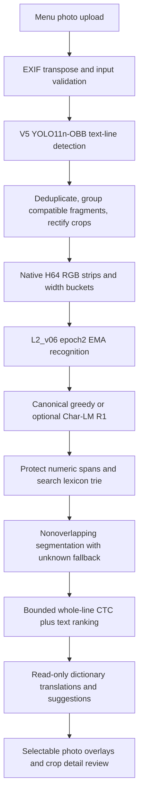

# Implementation Plan & Session Handoff (2026-11-20)

This is the current implementation record for the **Python Japanese-menu OCR and dictionary-translation prototype**. It replaces the 2026-11-17 roadmap: Char-LM decoding, trie lookup, contextual confusables and full-menu inspection are now implemented. **Automatic fuzzy correction and mobile migration remain unapproved.**

## 1. Current status and pipeline



The arrows describe the usual single-window path. Overwide crops use overlapping recognition windows and merged canonical greedy; joint LM decoding/CTC ranking is unavailable for that route. Exact translation lookup and text-only suggestions still work.

| Component | State |
|---|---|
| V5 detection, refined crop grouping and L2_v06 recognition | Implemented locally |
| Greedy/plain CTC beam/immutable schema-v2 Char-LM and R1 routing | Implemented in Python; modes selectable in inspector |
| Exact and 1–2-edit trie search, segmentation, translation retrieval | Implemented; fuzzy results are suggestions only |
| Contextual confusable catalog and visual CTC candidate ranking | Implemented with explicit provenance and limits |
| Full-menu upload, asynchronous jobs, selectable polygons and review export | Implemented for local inspection |
| Linguistic morpheme/slot-transition model | Future work; current DP is lexicon-based, not a trained linguistic parser |
| Swift/Core ML/mobile decoder port and measured device latency | Not implemented/validated by this work |

## 2. Models and inference contracts

### Recognizer

- Registry: `src/recognition/current_model.json`; loader: `src/recognition/current.py`.
- **L2_v06 epoch2 EMA**, `checkpoints/l2_v06/epoch_02.pt`, SHA-256 `d1592d6b29e81476b82235072eb2efd7c84bd4a4ce5bf9f964b6407741948349`.
- Vocabulary: `checkpoints/l2_v06/vocab.json`, **1,779 characters + blank0**, SHA-256 `40d532789de881c88edf12f6ce857120159a85f568325036b5ea89378e6e7bc9`.
- Architecture: MobileNetV4 Conv Small → H4 learned Conv2d(960,256,k=(4,1)) height projection → orientation conditioning → temporal blocks → one residual packed BiLSTM (128 hidden units/direction) → CTC classifier. Width stride4.
- Inference is eval-only. All 147 BN buffers and source asset hashes remained unchanged in the implementation evaluations.
- Registry's recorded baseline remains **canonical greedy**. Optional inspector R1 mode does not change the registry or model weights; the registry's historical `char_lm_candidate_applied=false` field should not be mistaken for the current Python decoder implementation status.

### Detector and crop handling

- Selected V5 checkpoint: `outputs/detection/training/banana130_finetune_v5/yolo11n_menu_obb_banana130_best.pt`; SHA-256 `0cab3e1205c964621fa7f9d7e9647262895a9009260a174e3bb99174d8d5bf99`.
- Full-menu defaults: confidence0.35, detector input640, IoU0.70. These are prototype settings, not a guarantee every detected region contains text.
- Reuse `src/detection/line_crops.py`: oriented duplicate suppression, conservative compatible-fragment grouping, collision-bounded added margins and explicit unresolved-overlap flags. Detected text cores are not clipped merely to eliminate overlap.
- Rectification produces reading-axis strips. Horizontal flag0; native vertical flag1 with **one CCW rotation**, not two. The menu adapter passes `already_rectified_strip=True`.
- Normalize proportionally to **height64**, then replicate borders to width **128/256/384/512**. Valid lengths are `ceil(valid_width/4)` and exclude artificial right extension.
- Native H64 widths >512 use balanced <=512 windows with **100 normalized-pixel overlap**, followed by source-coordinate token ownership. Do not use legacy height-letterboxed CTC exports for this inspector route.
- Long-window output explicitly warns that it is merged greedy, even when the request selected R1; it does not claim ordinary concatenated logits or joint whole-line visual scores.

## 3. Decoding and language assets

`src/recognition/char_lm_beam.py` now includes the reviewed immutable/schema-v2 decoder implementation. The older claim that all patches are review-only is obsolete for this source module. Do not assume the separate legacy inspector was patched simply because the decoder was updated.

- Canonical decoding pools ASCII/full-width parenthesis probability mass before CTC collapse. Existing full-width decimal-digit normalization remains narrow; lookalike kanji/kana are not globally normalized.
- **Greedy:** collapse repeated frame labels and remove blank, using valid T.
- **Plain beam:** actual CTC prefix beam search with alpha0, distinct from greedy.
- **R1:** canonical greedy predicted length <=2 → keep greedy; otherwise forward HP1010 digit-neutral 4-gram beam, **alpha0.30 / beam5 / top-k6**. Routing uses the prediction, never ground-truth length.
- LM: `checkpoints/l2_v06/char_lm_4g_hp1010.json.gz`, schema2 `dig_unk_v2`; SHA-256 `e9b9a786926598c6aded0b16d78ba21a43b9309371829fad2c0ad993f3605bbd`.
- Immutable per-request configuration prevents the previous shared-LM mode mutation race. Incompatible LM schemas/modes are rejected. Digit-neutral tables cannot validly be tested as a separately trained raw-digit LM merely by toggling a flag.

**R1 is not a numeric-correction guarantee.** Prior validation found some monetary/numeric changes that damage initially correct values. Numeric protection in the trie stage preserves its decoder input; it cannot undo or guarantee against upstream OCR/LM mistakes. See [Char-LM validation](stage3_recognition/char_lm_validation.md).

## 4. Lexicon trie and translation lookup

### Assets and separation of responsibilities

The derived index has **11,740 unique tiered entries**: 646 curated core, 1,327 additional context phrases and 9,767 additional cleaned culinary entries. Compressed index is about199 KB; this is not its in-memory size. Index schema/provenance records source hashes.

- Core/context source: `outputs/recognition/experiments/h4_k41_l2_v06_p5pct_pairs_ep04/payload/menu_lexicon.json`.
- Optional cleaned expansion: `data/processed/lexicon_cleaned_argon/jmdict_food_cleaned.json`.
- Derived index: `outputs/recognition/implementation/lexicon_trie_python_20261119/artifacts/lexicon_index_v1.json.gz`.
- Translation repository: **read-only SQLite** `data/processed/lexicon/culinary_menu.db`, linking term IDs and existing English/readings/metadata. Missing or unlinked records remain explicit; no translation/allergen claims are invented.

The raw ~45k term list and whole promotional menu titles were **not** imported indiscriminately. The Char-LM stores character-sequence statistics, whereas the trie stores explicit terms; neither is a substitute for the translation database. No runtime scraping or external LLM is called by the inspector.

### Search and segmentation

1. Preserve raw OCR, canonical greedy, selected decoder output and proposed edits separately, with Unicode code-point span mappings.
2. Protect contiguous numbers, currency/price expressions, counts/units, percentages and structured dates/times before fuzzy matching. Retain unknown text and original values.
3. Traverse a trie using Levenshtein DP rows with pruning. Return consumed source spans, edit operations, actual edit counts and heuristic costs. Insertions/deletions/repeated characters are supported.
4. Default edit policy, conservatively enforced against both query and candidate length:
   - One character: **exact only**.
   - Two characters: <=1 edit, suggestion only.
   - Three–five characters: <=1 edit.
   - Six or more: <=2 edits, suggestion only.
5. Select nonoverlapping segments with DP, explicit edit/boundary/fragmentation costs, a small source-tier prior and unknown fallback. Do not force every line into dictionary words or claim linguistic morpheme boundaries.
6. Enforce actual search/candidate budgets. Inputs beyond active lookup length retain an unprocessed suffix and warning; they are not silently truncated.

### Confusable categories and meaning of edits

`confusables.py` contains an immutable provenance-bearing catalog:

- **11 cross-script lookalike pairs**, including 口/ロ, 力/カ, 工/エ, 二/ニ and ー/一; default heuristic substitution cost0.45.
- **59 ordinary OCR-confusion pairs**, including シ/ツ, small/large kana and voicing-mark errors; default cost0.65.
- Other substitutions/insertions/deletions retain ordinary cost1. These costs are **engineering ranking heuristics, not probabilities**. Every actual substitution still counts as one hard edit. No zero-cost/transitive equivalence or semantic normalization is introduced.

Candidate classifications: `exact`, `visual_confusable_suggestion`, `ordinary_fuzzy_suggestion`. Mixed ordinary edits or insertions/deletions cannot receive the visual-only label. Isolated 口/ロ stays exact-only; valid kanji words are not globally rewritten.

Example: `特上口ース` segments into exact `特上` and a visual-confusable suggestion `口ース → ロース`. The latter has **Hard1 / Heuristic0.45**, not an exact match. Inspector shows any existing ロース translation under **Suggested Matches & Translations**, contingent on accepting the suggestion. Exact translations remain literal matches after the agreed canonical normalization.

### Visual ranking and output policy

For single-window logits, generate a bounded set of complete candidate lines **including unchanged OCR**. Score each with exact CTC forward probability over valid frames, then rank using explicit text score plus **0.25 × CTC log-probability difference**. OOV/infeasible candidates are marked unscorable. Whole-line evidence is not a per-character posterior. LM frequency is not added a second time as a hidden trie frequency score.

Keep text-DP suggestion and visually ranked candidate distinct. **`auto_corrected=false` always**. Text-only input has no visual evidence; multi-window input cannot currently be jointly rescored. Exact/suggested translations never silently alter source OCR or labels.

**Particle-context guard:** `particle_guard.py` recognizes a bounded set of menu action contexts, such as `焼きで食べる` and `炭火で焼く`, plus preparation phrases ending in `で`. It preserves probable particles and suppresses ordinary fuzzy edits in the associated clause from both DP and visual ranking. Genuine lookalike suggestions elsewhere remain eligible. Exact lexical matches veto word-internal particle guesses; `おでん` is not globally split at `で`. Suppressed candidates remain in inspection details with explicit reasons. This dependency-free heuristic is **not** morphological parsing or proof of grammatical correctness; ambiguous/unrecognized constructions can be missed. `protect_particles` is configurable per request and defaults on. Current cached benchmark cohorts contain no triggering contexts, so they do not establish this guard's generalization; targeted phrase/word and CTC-exclusion regressions cover its intended behavior.

## 5. Reusable implementation and inspection tool

| Location | Responsibility |
|---|---|
| `src/recognition/lexicon_lookup/contracts.py`, `normalization.py`, `protected_spans.py` | Request/result contracts, canonical/source offsets and protected spans |
| `index.py`, `trie_search.py`, `confusables.py` | Provenance-bearing index, bounded edit search and confusable catalog |
| `segmentation.py`, `ctc_scorer.py`, `translation_repo.py`, `pipeline.py` | Segmentation, visual probability/ranking, read-only translations and crop/text orchestration |
| `menu_pipeline.py`, `menu_jobs.py` | Full-menu detection/cropping/inference and bounded single-worker async jobs |
| `scripts/recognition/lexicon_lookup_cli.py` | Text/image CLI and index building |
| `scripts/recognition/serve_lexicon_inspector.py` | Current full-menu/crop/text inspection UI, default localhost8772 |
| `scripts/recognition/serve_l2_v02_inspector.py` | Older L2_v06-versus-L2_v05 comparison tool, separate port8765 |

Full-menu UI accepts JPEG/PNG/WebP, applies EXIF transpose and bounds encoded bytes/decoded pixels. HEIC is not enabled in the current decoder; convert it before upload. It displays the original photo with numbered SVG polygons, optional raw boxes, synchronized crop list and cached details. Selection does not rerun detection/OCR. Zoom/resize coordinates use the source-image viewBox.

Jobs expose submit/status/result/crop-detail/rerun/cancel endpoints under `/api/menu/jobs`. New settings generate a new job/config signature. Queue/resident limits, per-crop error isolation, progress reporting and flushed error tracebacks prevent an opaque all-or-nothing request. Review JSON contains menu/crop/config/asset provenance; accept/reject notes do not modify the source DB or labels. UI uses safe text DOM rendering, not dynamic HTML interpolation.

**Fixed post-launch bug:** merged fragment decisions contain nested source-ID groups. Provenance matching now traverses groups safely instead of hashing lists; a regression test covers overlapping fragments. This was an inspector adapter failure, not a model failure.

### Run locally

```powershell
# Run from the repository root; use a free port if another owned server is active.
.venv-recognition\Scripts\python.exe -u scripts/recognition/serve_lexicon_inspector.py --host 127.0.0.1 --port 8772 --device cpu

# Pure text lookup; no detector or recognizer required.
.venv-recognition\Scripts\python.exe scripts/recognition/lexicon_lookup_cli.py --text "特上口ース 1,200円"

# Single crop through OCR, optional R1 and trie lookup.
.venv-recognition\Scripts\python.exe scripts/recognition/lexicon_lookup_cli.py --image <crop.png> --decoder beam4g_dn_r1
```

Launch commands are reproducible instructions, not a promise a previous background process is still live. Check `/api/health`. Current task logs and handover live under `outputs/recognition/implementation/lexicon_trie_python_20261119/`.

## 6. Validation and practical limits

Same saved canonical FP32 model predictions; CER percentages below. Trie results are **hypothetical if the ranked candidate were applied**, not automatic production corrections.

| Arm | val10:129 crops/10 menus | reused test5:62 crops/5 menus |
|---|---:|---:|
| Canonical greedy | 5.71%,107 exact | 7.84%,50 exact |
| Char-LM R1 | 3.62%,117 exact | 6.58%,53 exact |
| Greedy + text-only fuzzy replacement | 7.66%,98 exact | 9.72%,48 exact |
| Greedy + CTC/text-ranked candidate | 5.29%,110 exact | 7.84%,50 exact |
| R1 + CTC/text-ranked candidate | 3.48%,118 exact | 6.58%,53 exact |

No previously correct predictions were damaged by visual ranking on these two small development sets; this does **not** establish safety on new menus. test5 has been reused and contains only one vertical crop. Confusable category/cost refinement preserved measured output parity with the prior prototype rather than producing an extra accuracy gain.

- Protected-span input→suggestion invariance: val10 **62/62**, test5 **27/27**, digit probe **514/514**. This differs from ground-truth numeric accuracy: e.g. val10 remains59/61. Earlier decoder mistakes can persist.
- Exact lookup covers about63–65% of non-protected characters on the reported menu sets. The reported74–79% translation hit rate is **among matched exact segments**, not all menu text and not independently verified translation accuracy.
- Missing valid terms can be pulled toward unrelated neighbors. Blind fuzzy replacement is rejected by current evidence. On long512 clean, text-only fuzzy CER worsens **3.68% → 8.16%**; that cohort has no cached visual-ranking evaluation in the current report.
- Initial real full-menu smoke: **13 detections/crops,13 successful executions**, about1.46s total on desktop CPU. A later post-fix smoke completed13 crops in about1.01s. These demonstrate execution only, not OCR correctness or iPhone speed.
- Relevant recognition/decoder/HTTP/geometry tests and the nested-merge regression passed in local checks. Test counts change as cases are added; rerun the suite rather than treating a historical count as completeness proof.

Primary evidence: local `evaluation_report.json` (schema2), `full_menu_smoke_report.json`, `artifacts/confusable_catalog_v1.json` and `HANDOVER.md` under the implementation output root; tests in `tests/recognition/test_lexicon_lookup.py` and `test_full_menu_inspector.py`. Earlier Char-LM read-only validation lives in `outputs/recognition/validation/char_lm_20261119/` and `char_lm_followup_20261119/`.

## 7. Next work and approval boundaries

1. **User review first:** inspect real uploaded menus, record bad crops, missing terms, spurious suggestions, amounts and translation gaps using exported review JSON. Separate detector, recognizer, decoder and dictionary failures.
2. **Fresh blind confirmation:** obtain new photographed/printed-and-recaptured menu pages excluded from all tuning. Report menu-level CER/exact rates, short/vertical/price errors, suggestion precision/damage and stage timings. Reused test5 is insufficient for a correction gate.
3. **Reviewed lexicon expansion:** add missing culinary terms with source/review status and verified translation links. Cleaned menu title corpora can suggest candidates; Char-LM n-grams are not themselves word definitions. Broader LLM slot extraction and learned slot transitions remain optional future work.
4. **Long-line completion:** evaluate overlap seam ownership and repeated characters, then design joint LM/visual ranking without pretending independent window logits are one sequence.
5. **Only after Python approval:** port to mobile/Core ML and native decoding/index/database access, preserve parity/geometry/contracts, profile model compute placement, load/memory and full-page latency on the actual iPhone. Desktop timings and earlier estimates are not device measurements.
6. Keep automatic fuzzy correction **off** unless separately approved following independent evidence. Model registry promotion, retraining, bulk scraping and deployment require their own authorized tasks; updating this document performs none of them.

## 8. Related records

- [Current model status](stage3_recognition/current_status.md) and [L2_v06 promotion](stage3_recognition/l2_v06_promotion.md).
- [L2_v01–L2_v02 dataset/training summary](stage3_recognition/l2_v01_v02_dataset_training_summary.md).
- [Historical V60–V75 dataset/training summary](stage3_recognition/v60_v75_dataset_training_summary.md).
- [Char-LM validation](stage3_recognition/char_lm_validation.md).

Earlier scraping/decoder pilot measurements and proposed slot-transition architecture are historical research, not current runtime guarantees. Existing scraper modules remain separate data-preparation tools; website access/policies must be rechecked before any new collection task.
