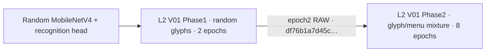

# L2 V01 — glyph-first random-start lineage

Verified 2026-11-17 after the user renamed the former **H4 V81** experiments to **`l2_v01`**. This is a new weight lineage, not a continuation of original V75 or H4 V75. `L2` is the lineage name: it does **not** mean two BiLSTM layers.

## Identity and ancestry

| Phase | Current experiment folder | Historical identifiers retained inside artifacts |
|---|---|---|
| Phase1 | `outputs/recognition/experiments/h4_k41_l2_v01_p1_rand160k` | `downloads/h4_k41_v81_p1/`, `v81_p1_corpus_audit.json`, `h4_k41_v81_p1_eval_report.json`, original job IDs |
| Phase2 | `outputs/recognition/experiments/h4_k41_l2_v01_p2_v71mix160k` | `downloads/h4_k41_v81_p2/`, `v81_p2_corpus_audit.json`, `h4_k41_v81_p2_eval_report.json`, original job IDs |

Folder renaming does not change model contents. **All 10 epoch checkpoint SHA-256 values were recomputed and matched their saved inventories** after the rename: two Phase1 files and eight Phase2 files. Phase2's recorded source hash exactly matches Phase1 epoch2. The initial random-state source hash in Phase1 is `5fadcbde678793adda9c0da6d03a01a1a9fa2e7f54f16c8bddc40fd0e230c29c`; the initial artifact itself was not reconstructed in this documentation check.

Historical remote paths and job/report identifiers deliberately remain unchanged. Do not edit checkpoint internals, source labels or immutable audits to make their names match the new directories. Use the current paths above for local access.

## Architecture

MobileNetV4 Conv Small → learned **Conv2d(960,256,kernel=(4,1))** height collapse → orientation conditioning → two residual temporal convolution blocks → **one** residual packed BiLSTM (128 hidden units per direction) → CTC classifier. Final encoder height H4, delayed width stride 4, H64 RGB input and width buckets 128/256/384/512. Valid lengths follow the width-stride-four contract for recurrence, CTC and decoding. Vocabulary is 1,779 characters plus blank 0; total model parameters **3,365,204**.

Native vertical means upright glyphs stacked top-to-bottom then rotated counterclockwise into a horizontal strip with flag1. Horizontal images use flag0. This is actual orientation coverage, not only different flags on identical horizontal images.

## Dataset and purpose

| Phase | Fixed corpus per epoch | Purpose | Actual training |
|---|---|---|---|
| **Phase1: glyph foundation** | **160,000 synthetic records:** 64,000 single-character (40%); 24,000 each of random 2-, 3-, 4- and 5-character strings (15% each). **80,000 H / 80,000 V.** | Learn visual glyph identities and CTC alignment before relying on meaningful menu sequences. Random strings are deliberate recognition exercises, not claimed menu phrases. | **2 full epochs, 320,000 presentations, 5,004 optimizer updates.** |
| **Phase2: menu integration with glyph replay** | **160,000 synthetic records:** 16,000 single-character (10%); 32,000 random 2–4-character strings (20%: 10,668 two-char, 10,666 three-char, 10,666 four-char); 112,000 V71-menu records (70%). **80,000 H / 80,000 V.** Corpus audit reports **521/521 exact curated terms**. | Add menu structure and broader recognition while retaining explicit glyph exercises. V71 denotes a data recipe, not inherited V71 weights. | **8 full epochs, 1,280,000 presentations, 20,016 optimizer updates.** |

Total: **10 full phase-specific passes, 1,600,000 presentations, 25,020 updates**. The two phase corpora are different; this is not ten passes over one shared dataset. No YOLO crops entered either training corpus; camera crops were used for evaluation.

Both corpora use six procedural backgrounds: warm off-white paper, pale wood, dark wood, chalkboard, mottled card and photographic gradient, with configured glyph-size/margin variation and readable ink contrast. Counts below were independently recomputed from saved corpus manifests; they are assigned appearance categories, not a fresh pixel-quality audit.

| Assigned appearance | Phase1 | Phase2 |
|---|---:|---:|
| Clean | 40,145 (25.09%) | 68,200 (42.63%) |
| Mild | 56,284 (35.18%) | 66,912 (41.82%) |
| Erode | 31,785 (19.87%) | 12,599 (7.87%) |
| Dilate | 31,786 (19.87%) | 12,289 (7.68%) |

Phase1 therefore has substantially more morphology than the earlier 50%-clean /45%-mild /5%-morphology continuation recipe. Do not describe its data as identical to that recipe.

## Weight and optimizer setup

| Setting | Phase1 | Phase2 |
|---|---|---|
| Starting state | New random backbone/head lineage | Phase1 epoch2 **RAW**, not EMA |
| Trainable weights | All 163 parameter tensors, including BN affine | All 163 parameter tensors, including BN affine |
| BN running statistics | **Update** | **Update** |
| Base learning rate | **3e-4 across all modules** | **3e-4 across all modules** |
| Optimizer | AdamW; weight decay 0.01 on matrix/convolution weights, zero on norm/bias | Same recorded policy |
| Precision | BF16 training, FP32 CTC | BF16 training, FP32 CTC |
| Reported training time | 346.98 seconds | 1,478.32 seconds |

The audit's `bn_module_count=0` / `bn_buffer_count=0` refer to the frozen-BN audit set. A loaded Phase2 RAW state contains **147 actual BN buffers**. Zero does not mean BN was removed. This is unlike the low-LR frozen-BN H4 V74/V75 adaptations. Phase2 starts from Phase1 weights; the audit reports `resumed_from=null`, so do not call it an optimizer-state resume.

## Recognition results and checkpoint roles

Phase2's saved evaluation compares RAW and EMA at epochs 2, 4, 6, 7 and 8. These are diagnostic comparisons, not evidence of an independently predeclared promotion selection.

| CER, same saved Phase2 evaluation | Epoch6 RAW | Epoch8 RAW | Epoch8 EMA |
|---|---:|---:|---:|
| Clean one-character | 10.50% | 8.00% | 7.00% |
| Clean two-character | 8.75% | 5.00% | 6.25% |
| Noisy one-character | 17.00% | 16.00% | 14.50% |
| Noisy two-character | 12.50% | 11.50% | 11.75% |
| Random 1,000 one-character images | 8.70% | 6.40% | 6.20% |
| Held-out digits | 17.91% | 15.35% | 15.64% |
| Held-out parentheses | 8.53% | 8.53% | 8.98% |
| Resized held-out fonts | 5.36% | 4.82% | 4.89% |
| Clean / noisy long512 | 4.36% /7.86% | 4.12% /7.34% | 3.96% /7.60% |
| Old YOLO validation, 68 crops | 45.05% | 48.18% | 50.52% |
| Old YOLO test, 88 crops | 28.70% | 36.70% | 38.09% |
| New 60-menu collection, 885 crops | 22.20% | 25.42% | 27.50% |

At epoch8 RAW, clean short-text exact counts are **184/200 one-char** and **180/200 two-char**; the separate random probe has **936/1,000 one-char**, **445/500 two-char** and **206/250 four-char** exact. These results are a major improvement over H4 V74's legacy short-text weakness.

**Research candidates to preserve:** epoch8 RAW/EMA for glyph/general synthetic recognition, and epoch6 RAW for camera adaptation. These are task-dependent candidates, not a declared universal best. Late camera regression is especially visible in the new-60 vertical subset: epoch6 RAW **24.96%** → epoch8 RAW **30.16%**, while synthetic short text continues improving. Do not attribute the cause solely to BN or overfitting without a controlled test.

For context, earlier H4 V74 epoch2 RAW scored **19.55%** on new60 and **4.11%** on held-out digits, but **77% /39.75%** on clean one-/two-character probes. L2 V01 is a stronger visual/short-text foundation, not yet an established replacement for the camera-adapted H4 baseline. Cross-run ranking still requires identical input/decoder checks; no paired confidence intervals or fixed 2,400-image H/V evaluation are included in the Phase2 report.

## Source files and limits

- Phase1: `manifests/v81_p1_corpus_audit.json`, `manifests/v74_replay_corpus.jsonl`, `downloads/h4_k41_v81_p1/{train_audit.json,checksums.json,epoch_02.pt}`.
- Phase2: `manifests/v81_p2_corpus_audit.json`, `manifests/v74_replay_corpus.jsonl`, `downloads/h4_k41_v81_p2/{train_audit.json,checksums.json,epoch_06.pt,epoch_08.pt}`, `evaluation/h4_k41_v81_p2_eval_report.json`.
- Phase1 epoch2 SHA: `df76b1a7d45cc9d279f5f48a1d2441a35809faa6b7020ea94ec6e5226b7b6407`.
- Phase2 epoch6 file SHA: `da348129c518f4c7b9fd91042397048a9f1e58c8ad7c02e9411d54f8b67ce2ba`.
- Phase2 epoch8 file SHA: `e158276f298122aec1f4639543e0c63d91cca2a5ca60b95f87ec2cb8b79fb7e4`.

Checkpoint files contain separate `raw` and `ema` states; a file checksum alone does not specify which one was evaluated. Preserved logs contain historical remote paths, not proof those paths still exist locally. Production remains V43 in its registry. No training, promotion, cleanup or artifact-internal renaming was performed for this documentation update.
