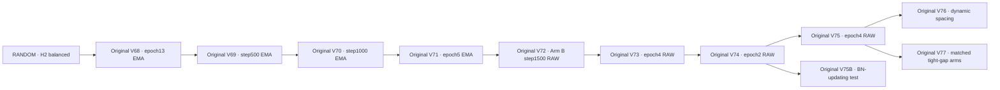
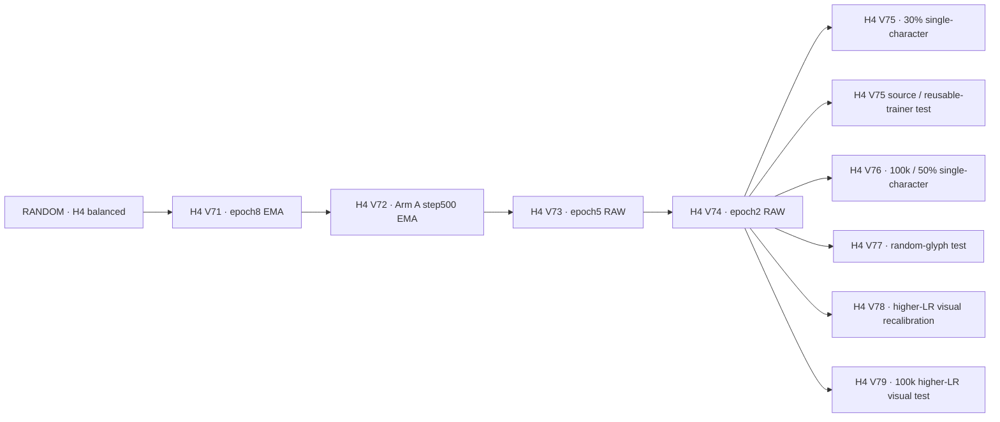

# Recognition model lineage — compare families, not version numbers

Snapshot: 2026-11-17. This guide separates **weight ancestry**, **architecture**, and **reused training recipes**. A larger version number does not imply a better model or a child of the preceding number. RAW and EMA in the same checkpoint are different weight states. Suggestions below are documentation aliases; no artifact, checkpoint or registry was renamed.

## Start here

| Family / suggested alias | Architecture | Initial weights | Main role |
|---|---|---|---|
| **Legacy / Mean-Legacy** | Mean over height → Conv1d; later residual BiLSTM | Earlier training history; not reconstructed here | V1–V52 development; promoted V43 belongs here |
| **Mean-Scratch** | Mean height pooling + one BiLSTM | **Random V53** | V53–V59 synthetic curriculum |
| **ConvH2-Horizontal** | H2 → Conv2d `(2,1)`; width stride 4; one BiLSTM | **Random V60** | V60–V67; initially missing native vertical training |
| **ConvH2-Balanced** | Same H2 architecture | **Random V68** | V68–V77 balanced orientation, then YOLO adaptation |
| **Architecture-Ablations** | Stride 2, delayed stride 4, H4 projection, or two BiLSTM layers | **Independent random starts** | Compare architecture under V60's dataset/settings |
| **ConvH4-Horizontal** | H4 → Conv2d `(4,1)`; delayed width stride 4; one BiLSTM | **Random H4 V60 ablation** | Horizontal-only V61→V62→V63 recipe follow-up |
| **ConvH4-Balanced** | Same H4 architecture | **Random `h4_k41_v71_random10`** | Native H/V training, then H4 V72/V73/V74 and sibling adaptation tests |
| **ConvH4-Scratch-Visual** | H4 architecture | Separate scratch experiments | H4 V80 phases; not descendants merely because their numbers are larger |
| **L2 V01 / H4-GlyphFirst** | H4 projection, width stride 4, **one** BiLSTM | **Random Phase1 → Phase2** | Former H4 V81, now renamed `h4_k41_l2_v01_*`; glyph foundation followed by menu integration |

**Recorded production (updated 2026-11-19):** `src/recognition/current_model.json` explicitly selects **L2_v06 epoch2 EMA**, H4, under user authorization. V43 remains rollback. L2 V01's subsequent L2_v02→v03→v04→v05→v06 adaptation is summarized in [the implementation handoff](../implementation_plan.md); see the exact [promotion record](l2_v06_promotion.md). This is separate from approval of Char-LM/R1 candidate patches, which remain unapplied.

## The two most important ancestry maps

The H4 sibling edges above are verified from source SHA-256 values in downloaded training audits, matched to H4 V74 `epoch_02.pt`: **`31e46a17cecb…`**. H4 V76/V77/V78/V79 do **not** form a sequential weight chain. Their numerical names describe experiments, not ancestry.

## Mean-Scratch: V53–V59

Every arrow below means actual inherited weights, not just a reused recipe.

| Child | Actual parent state | Descriptive name |
|---|---|---|
| V53 | **Random**, entire backbone and head | Mean-Scratch-Base |
| V54 | V53 epoch9 RAW | Mean-ShortDigits |
| V55 | V54 step2000 RAW | Mean-BroadParentheses |
| V56 | V55 epoch1 RAW | Mean-BroadContinuation |
| V57 | V56 epoch4 EMA | Mean-ShortPricesKanji |
| V58 | V57 epoch5 EMA | Mean-MenuBackgrounds |
| V59 | V58 epoch5 EMA | Mean-CuratedShortTerms |

V54 also has an interpolated EMA candidate; **V55 did not use it**. V53 updates BN statistics; V54–V59 freeze running statistics while learning weights. These runs did not train native vertical data or YOLO crops. See [dataset and settings report](v53_v59_dataset_summary.md).

## ConvH2-Horizontal: V60–V67

`RANDOM V60 → V61 RAW2000 → V62 RAW epoch1 → V63 RAW epoch5 → V65`.

V60's source for V61 is **best RAW epoch10**, not V53 weights. V60 reused V53's data/settings with a different height projection.

| Branch | Parent | Purpose / important distinction |
|---|---|---|
| V64 Arm A / B | Independently V63 epoch5 RAW | Recurrent/head-only versus full fine-tuning; **V65 did not start from V64** |
| V65 | V63 epoch5 RAW | Scale, margins and procedural menu backgrounds; epoch1 EMA retention-selected, epoch5 EMA stronger on some camera/appearance probes |
| V66 | V65 epoch5 EMA | Add 30% native vertical; horizontal forgetting; no eligible selection |
| V67 control / treatment | Independently V65 epoch5 EMA | CTC versus horizontal teacher KL; treatment EMA500 passed narrow guards |

V60–V65 had **zero native-vertical training**. V66/V67 attempted adaptation; V68 subsequently restarted randomly instead of inheriting either run. V60 updates BN; adaptations freeze its running buffers. See [V60–V75 settings](v60_v75_dataset_training_summary.md).

## ConvH2-Balanced: original V68–V77

Use the first diagram for exact parent states. V68 trained randomly on **196k, 50/50 H/V**, for 15 full passes. V69/V70/V71 reused V61/V62/V63 recipes, but **did not inherit V61/V62/V63 weights**. V68 updates BN; subsequent adaptations freeze its running buffers.

| Alias | Original version | Change |
|---|---|---|
| H2-Balanced-Base | V68 | Random balanced-orientation training |
| H2-Balanced-ShortDigits / Broad / Prices | V69 / V70 / V71 | Sequential synthetic curriculum |
| H2-Balanced-Short / Backgrounds | V72 / V73 | Matched adaptation, then scale/background training |
| H2-YOLO-Old | V74 | 25% old YOLO crops, two passes |
| H2-YOLO-OldNew | V75 | Add 492 new eligible crops; selected epoch4 RAW |
| H2-YOLO-BNUpdating | V75B | Independent child of V74; not V75's parent |
| H2-YOLO-DynamicGaps | V76 | Child of V75; corrected native-H64 long-line splitting in Attempt 2 |
| H2-YOLO-TightGapMatched | V77 | Two independent children of V75, not V76 |

V69, V70, V71 and V73 continuation candidates failed at least one original guard; downstream authorization did not retroactively make them eligible. V74/V75 had eligible selections. V76/V77 did not clearly establish a generalization upgrade over V75. Earlier superseded V68 folders are **not** the completed `v68_v60_recipe_full15_colab` lineage.

## Architecture-Ablations and ConvH4-Horizontal

All ablation branches below start independently from **random weights**, matched to V60's horizontal-only corpus. They are not fine-tuned V60 weights.

| Branch folder / arm | Width stride / final H | Recurrent layers | Description |
|---|---|---:|---|
| `v60_architecture_branches` / `v60_stride2_random10` | 2 / H2 | 1 | Preserve width resolution into temporal head |
| Same root / `v60_bilstm2_random10` | 4 / H2 | 2 | Additional recurrent depth |
| `v60_stride_height_ablation` / `v60_delay_s4_random10` | 4 delayed / H2 | 1 | Delay width downsampling to final stage |
| Same root / `v60_h4_k41_random10` | 4 delayed / H4 | 1 | Preserve height resolution; projection kernel `(4,1)` |

`v60_v61_63_followup` takes the **delayed-stride4 and H4 ablation branches**, then applies V61→V62→V63 recipes separately to each. Those stage names describe recipes, not global version ancestry. The H4 V63-stage epoch5 RAW was strongest on most synthetic probes. It still had **no native-vertical training**.

## ConvH4-Balanced: the separate H4 V71–V79 family

The second diagram is this family's ancestry. **`h4_k41_v71_random10` is a new random start**, not the horizontal H4 follow-up continued or original V71 converted to H4.

| Suggested alias | Exact experiment folder | Verified source / role |
|---|---|---|
| H4-HV-Base | `h4_k41_v71_random10` | Random, 160k 50/50 H/V, ten passes; epoch8 EMA used downstream |
| H4-HV-ShortMatched | `h4_k41_v72_v73_from_v71ep08` / V72 | H4 base epoch8 EMA; selected Arm A step500 EMA |
| H4-HV-Backgrounds | Same folder / V73 | V72 selected EMA; five passes; **actual next-run source epoch5 RAW**, despite earlier recommendation also retaining epoch4 RAW |
| H4-YOLO-Base | `h4_k41_v74_from_v73ep05` | H4 V73 epoch5 RAW; two passes, 25% YOLO; epoch2 RAW is the shared branch source |
| H4-SingleChar30 | `h4_k41_v75_1char30_yolo15` | H4 V74 epoch2 RAW; 30% one-char /15% YOLO; modest short-text gain |
| H4-ReusableTrainerCheck | `h4_k41_v75_src_test` | Independently H4 V74 epoch2 RAW; a separate implementation/source test |
| H4-SingleChar50-100k | `h4_k41_v76_100k_1char50` | Independently H4 V74 epoch2 RAW |
| H4-RandomGlyph | `h4_k41_v77_randglyph_yolo15` | Independently H4 V74 epoch2 RAW |
| H4-VisualHigherLR | `h4_k41_v78_highlr_visual_recal` | Independently H4 V74 epoch2 RAW; audit reports recurrent branch frozen |
| H4-VisualHigherLR-100k | `h4_k41_v79_100k_highlr_visual` | Independently H4 V74 epoch2 RAW; audit reports recurrent branch frozen |

V76–V79 evaluation files exist, but this guide verifies **ancestry**, not their ranking or full training integrity. Their reusable-trainer audits also report weight decay on all parameter groups, unlike the preceding corrected exclude-norm/bias policy; do not assume every setting is identical across siblings.

## Additional scratch experiments found locally

| Folder | Evidence / ancestry limit |
|---|---|
| `h4_k41_v80_scratch_p1_rand` | Separate scratch-labelled phase; initial source SHA `fd597347fd1d…`. Random-initialization audit was not independently reconstructed for this guide. Do not attach it to H4 V79 based on numbering. |
| `h4_k41_v80_scratch_p2_vocab` | Source RAW SHA `1e5967260bcd…` matches **V80 phase1 epoch2**. This parent edge is verified. |
| Former H4 V81 | Renamed by user to **L2 V01**; both completed phases and their parent hash have now been verified. See below. |

Folder presence does not establish a live job, completion, or approval. This documentation task does not poll or launch training.

## L2 V01: new glyph-first lineage (formerly H4 V81)

**Random backbone/head → `h4_k41_l2_v01_p1_rand160k` epoch2 RAW → `h4_k41_l2_v01_p2_v71mix160k`.** This is independent of H4 V74/V75/V80, and `L2` does not mean a two-layer BiLSTM.

Phase1 trains 160k synthetic glyph records (40% one-char, 60% random 2–5-char) for two epochs. Phase2 trains a new 160k corpus (10% one-char, 20% random 2–4-char, 70% V71-menu representation) for eight epochs. Both have 50/50 H/V, all weights train, BN statistics update, and base LR3e-4 across modules. No YOLO training crops. All ten epoch hashes match inventories after rename; Phase2's source is exactly Phase1 epoch2 RAW (`df76b1a7d45c…`).

Phase2 epoch8 RAW/EMA are useful short-text candidates; epoch6 RAW is the stronger camera candidate among the reported Phase2 states. No promotion. Historical internal `v81` paths/IDs and filenames remain unchanged. See the [complete L2 V01 dataset/training record](l2_v01_dataset_training_summary.md) for current artifact locations, appearance counts and metrics.

## Legacy versions V1–V52

Earlier work covered fixed/dynamic widths, data balance, fonts, short text, augmentation, BiLSTM introduction and vocabulary expansion. Do not draw a continuous V1→V52 arrow without checking archived source manifests. Exact early parent checkpoints were not re-audited here.

Useful confirmed branch distinctions:

- V32 height-convolution pilot was an exploratory branch, not the architecture inherited by promoted V43.
- V35 checkpoint **average3** supplied V36; an average is not the same state as V35's last checkpoint.
- V40 and V41 independently start from V38 with vocabulary expansion; **V41 is not trained V40 continued**. V41's selected EMA1000 starts V42; V42 final RAW2000 starts V43.
- V43 is the promoted legacy model. V47/V48 are independent V43 adaptations; V49 also starts from V43, and V50's normalized matched arms independently start from V43 rather than continuing V49 weights.
- V51/V52 are diagnostics/decoder comparisons, not evidence of a new trained parent for V53.

See the [historical index](../history/stage3_index_through_v52.md), [V53–V59 report](v53_v59_dataset_summary.md), [V60–V75 report](v60_v75_dataset_training_summary.md), and [original V76–V77 report](v76_v77_dataset_training_summary.md).

## How to name and compare future runs

Use **family + purpose + source state** in discussion, for example `H4-YOLO-Base / epoch2 RAW`, not just “V74”. Keep the exact artifact folder and SHA alongside it. Record four independent fields: architecture, parent checkpoint/key/SHA, dataset recipe, and selected versus final state. A reused recipe, a diagnostic evaluation and a new random start are three different relationships.

Compare checkpoints on the same input tensors, decoder, precision and split. “YOLO CER” may mean 156 old holdout crops, 88 test crops, 404 menus101–130 crops, or 885 new-60 crops; those numbers are not interchangeable. Native H64 splitting and historical height-letterboxed exports are also different evaluation inputs.

Sources: linked dataset reports; each family's `HANDOVER.md` and downloaded `DONE.json`/training audits; ablation `selected_arms.json`; checkpoint checksum inventories; `src/recognition/current_model.json`. Exact lineage is verified where explicitly stated; unresolved historical or newly staged states remain labelled instead of guessed.
