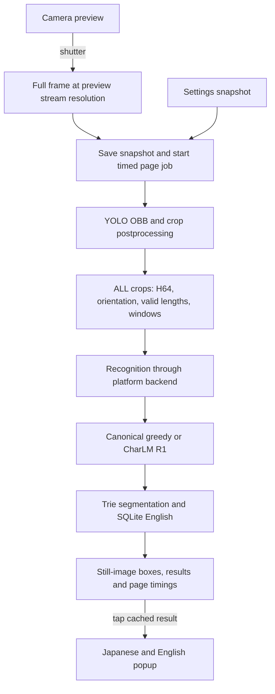

# Stage4 part1 — iPhone camera MVP implementation plan

Date:2026-11-23. **Implementation now authorized:** Flutter desktop demo plus Flutter/iOS Core ML integration foundation. Export/device verification remains pending. See [user requirements](user_requirements.md).

## 1. Architecture and data flow

**Flutter UI + Core ML inference on iPhone15** is the core foundation. Flutter owns camera controls, settings, still-image boxes, progress and popup. A native iOS plugin handles camera buffers/Core ML where needed; decoding and lookup stay behind a stable backend interface. No Python/server in the iPhone runtime.

Build a working **Windows Flutter desktop demo using the same screens/contracts**, with the existing local Python pipeline as its reference backend. Loopback IPC is allowed for desktop, not a hidden production-cloud dependency. Show backend/hardware identity; Windows latency does not estimate Core ML speed.

No inference runs on live preview by default. Each shutter action processes the whole menu, including all eligible detections and long-line windows; popup taps use cached results. Completion accounts for completed/failed/cancelled crops.

## 2. Asset bundle pin

Repository-relative paths below were independently hash-verified 2026-11-23. Export only resolved RAW weights; the 55.8 MB training checkpoint includes non-inference state and is not the proposed app payload size. Core ML sizes/memory remain unmeasured.

| Asset | Source path | SHA-256 |
|---|---|---|
| OCR candidate RAW | `outputs/recognition/experiments/l2_selected2105_short_recovery_1000/downloads/short_recovery/step_1000.pt` | `737cd2f82ebba5c85d95a3eb466040b5511de900db6e4ace3a7ee42de8b6c7c8` |
|2105vocabulary| `outputs/recognition/experiments/l2_selected2105_short_recovery_1000/payload/target_vocab_active.json` | `9e73532f1e6a9435a169ddab937cf736d66e1e57ce52eced13169172bee1ad9e` |
| V5 YOLO11n-OBB | `outputs/detection/training/banana130_finetune_v5/yolo11n_menu_obb_banana130_best.pt` | `0cab3e1205c964621fa7f9d7e9647262895a9009260a174e3bb99174d8d5bf99` |
| HP1010forward4gramDN/schemaV2 | `outputs/recognition/validation/char_lm_followup_20261119/candidates/char_lm_4g_hp1010_v2.json.gz` | `58721de9d92d9daf165dfc64d3f979b1ff9da83d253a6d2e11a2a7c8f99fbefb` |
| Lexicon V3 | `data/processed/lexicon/lexicon_index_v3_22112026.json.gz` | `192059a006582c3034a638dea4d0b27bb925e37750c73bf0f58d8614802d0fc5` |
| SQLite | `data/processed/lexicon/culinary_menu.db` | `ce8553abe75bce77bdb860da7d3773aabed975b8d74a5c1620ccca268bd39e59` |

Build a versioned bundle manifest with all source/converted hashes, model input/output interfaces, normalization, Unicode ID mapping, LM context transform, lexicon/DB versions and export toolchain. Reject mixed bundles visibly; preserve rollback. Production registry remains L2_v06; app uses an explicit experimental bundle reference.

LM tables cover 1,779 of 2,105 characters; 326 expanded characters use the audited Unicode smoothing fallback. No logits truncation or 1,779 ID remapping. Lexicon V3 has 12,471 entries; DB has 47,399 base rows plus 35 curated overrides and 230 phrase plans. GenAI101–130 informed these lexicon updates, so it is lexicon-development evidence.

## 3. Milestones and gates

### M0 — Build environment and Python golden fixtures

Check Windows Flutter SDK/build tools and camera/import support first; build the desktop reference without waiting for a Mac. For iOS, verify macOS/Xcode/Flutter/Core ML Tools, signing and physical iPhone15; pin actual versions/minimumiOS. **Windows cannot verify iOS builds or Core ML execution.** No remote Mac purchase or paid resource allocation is automatically authorized.

Resolve checkpoint RAW explicitly with shared checkpoint loader and instantiate actual `ARCH_SPECS['h4_k41']` in `src/recognition/model.py`, eval mode. No BN recalibration or weight edits. Freeze fixtures recording image RGB, orientation, validW/T, logits, canonical outputs, decoding settings and dictionary results. Include H/V,1/2 characters, repeated digits, prices/brackets, blank, bucket boundaries/non-multiple-of-4 widths, expanded Unicode and long windows. Use owned/generated fixtures for bundled tests; don't redistribute restaurant photos inside the app.

**Gate:** exact state/vocab/provenance, source baseline counts/CER and golden outputs fixed before conversion.

### M1 — Core ML conversion feasibility before building UI

Detector: start fixed 1024 input with existing V5 OBB configuration. Preserve input letterbox/normalization, class/angle convention, rotated NMS, inverse letterbox coordinates and `src/detection/line_crops.py` dedup/fragment merge/padding/overlap behavior. A generic axis-aligned YOLO/NMS export is not assumed equivalent.

Recognizer: preserve MobileNetV4 H4 stride pattern and learned height projection, orientation conditioning, temporal blocks, residual BiLSTM 128 per direction, 2,106-output classifier, eval-mode BN, RGB normalization and validT=ceil(validW/4). CNN/temporal features must use the SAME physical replicate-padded bucket as Python; tight CNN canvases can alter boundary features.

**Primary risk: packed BiLSTM export.** Python uses `pack_padded_sequence`/`pad_packed_sequence` and FP32 recurrence. Do not trace one length and freeze it, remove packing or allow backward recurrence through artificial padding.

Feasibility sequence:

1. Attempt equivalent explicit-valid-length export; inspect graph and compare multiple valid lengths within EVERY bucket. Exporter support is unproven until tested.
2. If packing is unsupported, split after temporal features: fixed/enumerated bucket CNN produces `[1,256,Tphysical]`; host slices the valid prefix; a second recurrent-residual/classifier model sees EXACT valid length. Consider finite EnumeratedShapes for recurrent lengths 1..128, batch 1. Verify actual converter/runtime support and overhead; no promise of ANE execution.
3. If needed, assess an equivalent explicitly masked forward/backward recurrence or a phone-local runtime fallback with the same parity tests. No padded BiLSTM approximation, server fallback or replacement model without an explicit revised plan.

Use float/FP16 export first, preserving FP32-sensitive computation if required. No INT8 in this milestone. Profile actual CPU/GPU/ANE execution; Core ML does not guarantee all operators run on ANE.

**Proposed mobile-conversion gates:** canonical greedy CER increase<=0.20pp overall on fixed synthetic heldout and genAI cohorts; no default short/medium/long stratum worsens>0.50pp; mandatory price/blank/orientation fixtures have no silent semantic regression. Logit comparisons use declared precision tolerances. These are export gates, not relaxed model-promotion thresholds. Failed parity blocks export acceptance.

### M2 — Shared Flutter contracts and platform adapters

| Proposed module | Responsibility |
|---|---|
|CameraService|Permission, preview, shutter snapshot, stream dimensions and orientation|
|PageJobCoordinator|One active page, all-line progress/cancellation, stage and wall timing|
|DetectorService|Core ML OBB outputs/configuration|
|LineCropProcessor|RotatedNMS/dedup/merge/rectification and sourcecoordinates|
|RecognizerService|H64 RGB,buckets,valid length,orientation,windows andlogitscache|
|CTCDecoder|Canonicalgreedy and immutable CharLMR1|
|LexiconService|Trie,particles/protectedspans,boundedDP and optionalCTC ranking|
|TranslationRepository|Read-only SQLite,overrides,phrasecomponents|
|AssetBundle|Bundle/version/hash compatibility|
|InspectionViewModel|Captured page/crop/config identity, cached selection and result state|

Shared Flutter backend interface has `DesktopReferenceBackend` (localhost Python) and `IOSCoreMLBackend` (native plugin). Contracts include `CapturedPage(captureID,time,streamSize,imageSize,orientation,sourceTransform)`, `PageRun(captureID,runID,configID,backendID)` and per-crop geometry/flags/windows/OCR/lookup/timings. Apply updates only when capture/run/config IDs still match. Retake cancels or invalidates old runs.

Keep images/tensors near native inference on iOS; avoid repeatedly transferring full frames through Dart. Desktop IPC must be loopback-only, bounded, path-allowlisted and protected by a session token. Do not expose the development worker on LAN. Reuse actual Python model/decoder/lexicon, not a cloned inspector or mock inference.

Use Unicode scalar/code point offsets matching Python; Swift grapheme/UTF-16 offsets cannot silently substitute. Pool ASCII/fullwidth parentheses probability mass BEFORE CTC collapse; narrow digit/parenthesis canonicalization, no global NFKC/confusable conversion.

Decoder defaults alpha 0.30, beam width 5, top-k 6/DigitNeutral; R1 routes predictions with <=2 greedy characters to greedy. Preserve prefix beam blank/repeat/log-sum-exp handling, unknown Unicode, numeric transformation and valid frames. Greedy andalpha-zero beam are different. Preserve numeric disagreement with greedy; do not silently introduce a new monetary routing policy.

Port existing lexicon semantics:12,471 tiered entries rather than all 47,399 DB terms as fuzzy candidates; bounded edit search,exact pre-pass,particle protection,protected prices,DP unknown fallback,curated phrase English/components. Auto-correct off; contingent fuzzy suggestions separate. Preserve `季節/の/先付/と/前菜` while protecting whole dish names. Read-only runtime includes overrides/phraseplans; no LLM calls.

Long lines: nativeH64 overlap512 with100 normalized pixels of overlap and coordinate-based output merging. Existing Python multiwindow path falls back to mergedgreedy wherejoint LM/visual rescoring unavailable. Match and disclose fallback in result metadata; do not claim global beam across windows.

**Gate:** Swift fixtures match Python text/segmentation/prices; explicit score tolerances, tiny CTC oracle and concurrency/config isolation tests. Measure LM load/workingmemory;2 MB gzipped is not runtime memory. Historical ~110 MB Windows LM memory is not an iPhone measurement.

### M3 — Capture-first Flutter UI and Windows demo

Flutter preview with Settings/shutter; after capture show a still-image result view with polygons, page progress/timings and Retake. Popup displays cached crop/Japanese/English. Desktop adds image import for repeatable testing or absent webcam; it must use the real pinned pipeline, not pretend fixture output is inference.

Snapshot actual configured camera stream pixels, not a widget screenshot or a separate higher-resolution still-photo capture. Save the full frame losslessly at the stream dimensions, modulo orientation swapping, to bounded app cache. Preserve source pixel and preview viewport transforms. If the camera plugin lacks a matching stream snapshot, implement a platform adapter; do not silently downsample a different still and claim identical capture. Detector1024letterboxing and recognizerH64 remain separate.

Each shutter run snapshots settings, normalizes/persists the image, detects and postprocesses, then recognizes/decodes/translates ALL crops. Bound serial/bucket-batch work and cache memory; isolate per-line failures and count long windows. No live inference or unbounded capture queue. Cancel/Retake invalidates pending results. Empty detections complete as a valid zero-line page.

Confidence applies to next capture or explicit Reprocess of the same still. Reuse raw detections only when threshold coverage is sufficient; otherwise rerun. Alpha/mode may reuse cached logits then lookup, but must mark cache usage. Missing cached logits trigger disclosed re-inference; do not mix configurations or call partial cached reprocessing a fresh page benchmark.

**Gate:** working Windows Flutter app, actual webcam capture when hardware is available, image import always, real all-line inference, correct box hit tests/cached popup, progress, reset/persistence, cancellation and timing. Existing review servers remain untouched.

### M4 — Device acceptance and delivery

Measure shutter-to-first-result and shutter-to-complete-page wall time; separately expose normalization/persistence, detection, crop processing, recognition, decoding and lookup. End timing only after all lines finish/fail or cancellation. Use monotonic clocks per process: desktop IPC clocks have different origins, so don't subtract unrelated timestamps. Synchronize GPU completion where required. Summed concurrent stage/crop work is not wall time.

Report cold/warm p50/p95 for15/30/50-line pages and actual line/window counts, input dimensions, confidence/alpha, backend/hardware, cache state, failures and peak memory. Total page time is primary. Establish an actual iPhone baseline before promising page latency; old3Hzlive-detection/1.5stap targets are superseded. Preview before capture and progress UI during processing should remain responsive; popup reads cached data promptly.

Use [default evaluation cohorts](../stage3_recognition/evaluation_default_cohorts.md): threeGT-length heldout-font resizing groups and genAI101–130 withtraining exposure disclosures. Add untouched printed/new real menus photographed with the phone under good lighting and varying distance; report detector recall, crop CER, exact dish/price accuracy and translation coverage separately. Do not tune on the final phone confirmation photos.

Deliver versioned export bundle manifest,conversion parity report,device benchmark,known limitations,reproducible build/signing/install instructions and developer build when implementation is authorized. AppStore publication is out of scope. Verify data/model redistribution rights before external distribution; a working personal prototype does not establish licenses.

## 4. Execution boundary

**Deployment route update,2026-11-23:** user chose GitHub macOS unsigned release build -> Windows free-Apple-ID signing through Sideloadly/AltStore Classic -> iPhone. See [installation guide](windows_free_apple_id_installation.md). `Payload/Runner.app` IPA packaging is for re-signing input, not directly installable unsigned distribution. Do not wait for CI Apple certificates/profile or require paid membership for this route; keep native parity/resources checks and physical-device acceptance.

Parallel tracks: **Windows M0 setup -> M2 desktop adapter -> M3 Flutter demo**, alongside **iOS M0 toolchain -> M1 export/parity -> M2 native adapter -> M4 device tests**. Lack of Mac access blocks only unverified iOS work, not desktop delivery. Share UI/contracts/fixtures; reuse Python code instead of duplicating pipeline workers.

Concrete blockers: no Mac/signing/device, unsupported valid-length conversion, mismatched bundle, numeric/geometry parity failure or unusable device performance. Report bounded alternatives; never silently retrain, switch weights, add remote cloud inference or promote registry. User now authorizes implementation and a desktop demo; purchases and AppStore release remain outside scope.

## 5. Official platform references

- [AVFoundation video output](https://developer.apple.com/documentation/avfoundation/avcapturevideodataoutput): camera-frame processing interface.
- [Apple handling frame drops](https://developer.apple.com/library/archive/technotes/tn2445/_index.html): late-frame handling and bounded processing.
- [Core ML Tools flexible shapes](https://apple.github.io/coremltools/docs-guides/source/flexible-inputs.html): EnumeratedShapes and finite input shapes.
- [Core ML Tools FAQ](https://apple.github.io/coremltools/docs-guides/source/faqs.html): enumerated-shape optimization and unsupported dynamic layers on Neural Engine.

Checked 2026-11-23. Recheck actual toolchain/runtime support in M0. Conversion strategies above are proposals, not verified exports.
